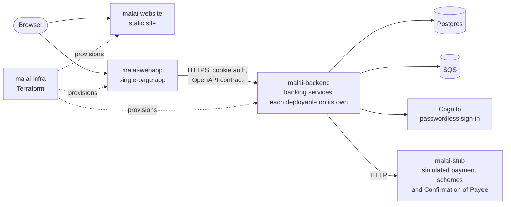

# Malai

**A reference UK retail banking platform.** It's a complete working bank you can evaluate end to
end, built so prospective bank operators can read the architecture, walk the customer journey
and judge the platform before commissioning one of their own.

- **Website:** [malaibank.com](https://malaibank.com)
- **Live demo:** [app.malaibank.com](https://app.malaibank.com). Register with a name and an email
  address.
- **End-to-end test report:** [malaibank.com/end-to-end-flows](https://malaibank.com/end-to-end-flows)

Malai is not a bank and is not regulated. Every person, counterparty, merchant and figure in it
is fictional.

## What's in this repository

| Module                            | What it is                                                                                                                                                                                                                                      | Stack                                                    |
| --------------------------------- | ----------------------------------------------------------------------------------------------------------------------------------------------------------------------------------------------------------------------------------------------- | -------------------------------------------------------- |
| [`malai-backend`](malai-backend/) | The banking core. One module per bounded context (auth, accounts, ledger, payments, cards, payees, standing orders, direct debits, insights, payment screening, AML, decision records, a copilot), each of which can be deployed independently. | Kotlin, Spring Boot, Maven, Postgres, Flyway, SQS, Kensa |
| [`malai-webapp`](malai-webapp/)   | One app with three surfaces behind a single passwordless login: customer **Banking**, the **Ops** back office, and the **Exec** dashboard, plus a **Sandbox** for simulating inbound payments and card activity.                                | React 19, Vite, TanStack Query, shadcn/ui, Tailwind v4   |
| [`malai-website`](malai-website/) | The marketing site at malaibank.com.                                                                                                                                                                                                            | Astro 7, Tailwind v4, Playwright, Lighthouse CI          |
| [`malai-infra`](malai-infra/)     | Infrastructure as code for running all of the above.                                                                                                                                                                                            | Terraform on AWS                                         |

Each module has its own README with the details.



## How it was built

Malai was built with [Claude Code](https://claude.com/claude-code), Anthropic's agentic coding
tool.

The main tool in that process was Matt Pocock's
[`grill-with-docs`](https://github.com/mattpocock/skills/tree/main/skills/engineering/grill-with-docs)
skill: a relentless interview that sharpens a plan or design and writes the decision records and
glossary as it goes. Every feature started there. To see what that looks like, read the
`.scratch/` folder in each module, where every feature has its product requirements and its
breakdown into issues:

- [`malai-backend/.scratch/`](malai-backend/.scratch/)
- [`malai-webapp/.scratch/`](malai-webapp/.scratch/)
- [`malai-website/.scratch/`](malai-website/.scratch/)
- [`malai-infra/.scratch/`](malai-infra/.scratch/)

The decisions those sessions produced live in each module's `docs/adr/`, the domain language in
its `CONTEXT.md` files, and the conventions the agent works by in its `CLAUDE.md`.

## Fully automated

Malai is automated from end to end. Each module had its own pipeline:

- **Infrastructure:** Terraform provisions the AWS environments. The pipeline validates every
  unit, then plans and applies to dev and then prod.
- **Backend:** the pipeline runs the full test suite and the end-to-end tests, and blocks
  breaking changes to the API contract. It then releases the container images with a security
  scan, deploys to dev and then prod, smoke-tests each deployment, and publishes the end-to-end
  report to the website.
- **Webapp and website:** the pipelines build and test, then deploy to dev and then prod. The
  webapp is smoke-tested after each deploy.

This public repository keeps only the **build** half of those pipelines. The GitHub Actions
workflows in [`.github/workflows/`](.github/workflows/) compile, lint and run every test suite on
each push and pull request. The release and deploy jobs need the AWS accounts, so they aren't
included.

## Testing is the first-class concern

Tests are the most important code in every module.

| Module        | What's tested                                                                                                                                                                         | Scale                                          |
| ------------- | ------------------------------------------------------------------------------------------------------------------------------------------------------------------------------------- | ---------------------------------------------- |
| malai-backend | Acceptance tests for every service, against a real Postgres and SQS (on Localstack), with WireMock standing in for downstream calls. End-to-end tests against the running containers. | ~1,800 tests, plus a 44-test end-to-end suite  |
| malai-webapp  | Components, pages and flows with Vitest and Testing Library. Also checks that the generated API client matches the contract.                                                          | ~1,500 tests                                   |
| malai-website | Playwright: page smoke tests, accessibility (axe), SEO, content security policy, forbidden terms. Lighthouse score gates.                                                             | ~130 tests; Lighthouse 95+ (accessibility 100) |
| malai-infra   | `terraform fmt` and `terraform validate` on every unit.                                                                                                                               | 15 units                                       |

The backend is tested with [Kensa](https://kensa.dev), a BDD framework where every test reads as
`given / whenever / then`. Kensa renders each test as plain sentences, together with a sequence
diagram of every HTTP and message exchange between the services, so a test report doubles as
documentation of how the bank works.

The end-to-end suite drives the real `malai-api` and `malai-stub` containers through whole
journeys:

- registration and sign-in
- accounts, transfers and payments
- payees and Confirmation of Payee
- cards, standing orders and direct debits
- spending insights and the sandbox
- payment screening, AML cases, decision records and copilot explanations

Its report is published at
**[malaibank.com/end-to-end-flows](https://malaibank.com/end-to-end-flows)**.

## Run it locally

Start the backend, load the demo data, then start the webapp against it.

### Prerequisites

| Tool            | Version                          | Needed for                                                                  |
| --------------- | -------------------------------- | --------------------------------------------------------------------------- |
| JDK             | 25                               | the backend                                                                 |
| Docker          | any recent version, with Compose | Postgres, Localstack, the end-to-end stack                                  |
| Node.js and npm | Node 24                          | the webapp and the website                                                  |
| `lsof`          | any                              | the backend's local scripts (present on macOS and most Linux distributions) |

Nothing needs an AWS account. Locally, SQS runs on Localstack and Cognito is replaced by a stub.

### 1. Start the backend

```bash
cd malai-backend
./start-docker-containers-local.sh   # Postgres on :5432 and Localstack SQS on :4566
./start-malai-api-local.sh           # builds, then runs malai-api on :8080; leave it running
```

`start-malai-api-local.sh` also starts two helpers, and stops them when you stop the API with
Ctrl+C:

- `malai-stub` on :9090, the simulated payment schemes
- `malai-cognito-stub` on :9095, the stand-in for AWS Cognito

The first build downloads Maven itself (through the wrapper, `./mvnw`) and the backend's
dependencies, so it takes a few minutes.

### 2. Load the demo data

In a second terminal:

```bash
cd malai-backend
./demo-reset-local.sh                # seeds the demo users and their banking history
```

### 3. Start the webapp

In a third terminal:

```bash
cd malai-webapp
npm ci
npm run dev                          # http://localhost:5173
```

### 4. Sign in

Open [http://localhost:5173](http://localhost:5173) and sign in as Sarah Mitchell, the main
demo customer: `sarah.mitchell@example.com`. To list every seeded user's email and roles:

```bash
curl -s http://localhost:9095/stub/users
```

The local Cognito stub accepts any confirmation code, for example `12345678`.

You can also register a new user from the login page. Registered users hold every role, so the
menu under your name opens the Ops back office, the Exec dashboard and the Sandbox too.

### The website (optional)

```bash
cd malai-website
npm ci
npm run dev                          # http://localhost:4321
```

### Run the tests

| Module        | Command                                                                                                                                          |
| ------------- | ------------------------------------------------------------------------------------------------------------------------------------------------ |
| malai-backend | `./start-docker-containers-local.sh && ./mvnw install`. The end-to-end tests are in its [README](malai-backend/README.md#run-the-end-to-end-tests). |
| malai-webapp  | `npm test`                                                                                                                                       |
| malai-website | `npm run build && npm run test:e2e`. Run `npm run test:e2e:install` once first to get Chromium.                                                  |
| malai-infra   | See its [README](malai-infra/README.md#ci).                                                                                                      |

## License

[MIT](LICENSE)
